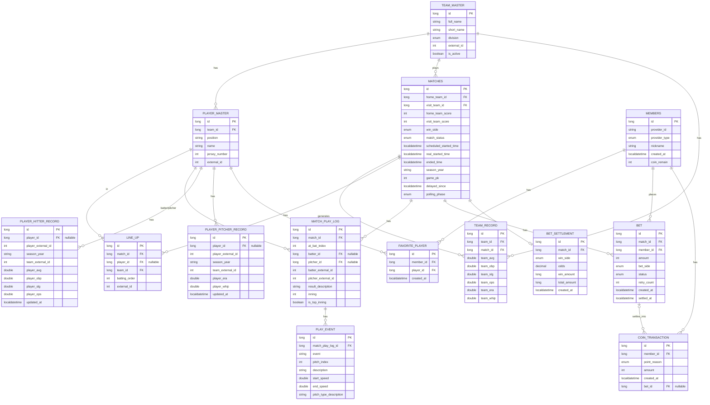

# MLB 승부예측 사이트 (가명)

## 소개

MLB API를 활용해 경기 진행 상황을 실시간 중계하고, 사용자는 원하는 팀에 베팅한다. 베팅한 팀이 승리하면 서비스 내 코인을 보상으로 획득한다.

MVP 단계에서는 모놀리식으로 개발하며, 트래픽 테스트를 거쳐 멀티 아키텍처 시스템으로 강화할 예정이다.

## 설계 문서

시스템별 상세 설계(상태 전이, 시퀀스 다이어그램, 정책, ADR)는 아래 문서에서 관리한다.

| 문서 | 설명 |
|---|---|
| [인증/인가 (AuthSystem)](src/main/java/docs/design/AuthSystem/AuthSystem.md) | JWT 인증/인가 정책, 에러 응답, ADR, 검증 결과 |
| [매치 시스템 (MatchSystemDesign)](src/main/java/docs/design/MatchSystem/MatchSystemDesign.md) | MLB API 동기화, 경기 상태 전이, 폴링·저장 정책, 실시간 중계 API |
| [베팅 시스템 (BetSystemDesign)](src/main/java/docs/design/Bet/BetSystemDesign.md) | 베팅 상태, 베팅 생성·정산 시퀀스, 보정 스캔 |

## 주요 기능

### 실시간 경기 중계
- 경기 상태(예정/진행중/지연/종료/취소), 이닝, 득점, 타석·투구 이벤트 업데이트
- WebSocket(STOMP) 기반 실시간 전송
- 경기별 채팅 시스템

### 최애 선수 시스템
- 최애 선수를 지정 가능 (최대 3명)
- 가장 최애가 많은 선수는 메인 페이지에 표시

### 베팅
- 경기 단위로 "승리 팀 맞히기" 형태
- 베팅 가능 시점: 경기 전 ~ 경기 시작 후 최대 8이닝 전. 진행된 이닝에 따라 포인트 지급량 감소 (경기 시작 전에만 가능하도록 변경할지 검토 중)
- 최애 선수가 POG(Player Of Game)로 선정되면 추가 포인트 및 해당 경기 뱃지 획득
- POG는 경기 결과를 OpenAI로 분석하여 선정

### 정산 및 보상 (코인)
- 경기 종료(FINAL) 확정 시점 기준으로 승/패 판정
- 적중 시 코인 지급, 실패 시 코인 차감, 경기 취소 시 환불

### 코인 사용
- 칭호, 프로필 아이콘, 마이페이지 치장 아이템 등 구매

## ERD



### Enum

| Enum | 값 |
|---|---|
| Division | AL_EAST, AL_CENTRAL, AL_WEST, NL_EAST, NL_CENTRAL, NL_WEST |
| PlayerPosition | PITCHER, CATCHER, FIRST_BASE, SECOND_BASE, THIRD_BASE, SHORTSTOP, LEFT_FIELD, CENTER_FIELD, RIGHT_FIELD, DESIGNATED_HITTER |
| Provider | GOOGLE, KAKAO, NAVER |
| Side | NONE, VISIT, HOME |
| MatchStatus | SCHEDULED, LIVE, DELAYED, FINAL, CANCELED, MATCH_SUSPENDED_UNKNOWN |
| PollingPhase | WAITING_START, STATUS, LIVE_PLAY |
| BetStatus | PENDING, WON, LOST, CANCELED, NONE, ERROR, FAILED |
| PointReason | SIGNUP_BONUS, CHARGE, BET_PLACED, BET_REWARD, BET_REFUND |

> 경기 상태 전이는 [매치 시스템 설계 5장](src/main/java/docs/design/MatchSystem/MatchSystemDesign.md#5-경기-상태-전이), 베팅 상태는 [베팅 시스템 설계 3장](src/main/java/docs/design/Bet/BetSystemDesign.md#3-베팅-상태)을 참고.

## 디렉토리 구조

도메인 단위로 패키지를 나누고, 각 도메인 하위에 entity / repository / service / dto를 둔다.

```
src/main/java
├── com/mlbbroadcast
│   ├── MlbBroadcastApplication.java
│   ├── bet              # 베팅 생성, 정산(settlement)
│   ├── coin             # 코인 거래 내역
│   ├── match            # 경기, 상태 전이, 폴링, 타석/투구 로그, 이벤트, 실시간 중계
│   ├── member           # 회원, 소셜 로그인 가입
│   ├── player           # 선수 마스터, 시즌 기록, 최애 선수
│   ├── team             # 팀 마스터, 경기별 팀 기록
│   ├── external         # 외부 API 클라이언트 (MLB Stats API, Google OAuth), 재시도
│   ├── security         # JWT 필터, 인증/인가 핸들러, STOMP 인증
│   ├── websocket        # 웹소켓 세션 관리
│   ├── configuration    # 설정, 예외/에러 코드, Redis·WebSocket·스케줄러 설정
│   ├── common           # 여러 도메인이 공유하는 타입 (Side, PlayerPosition)
│   └── util             # 토큰 발급, Redis 유틸
└── docs/design          # 시스템별 설계 문서
```

## ADR (전체 공통)

> 시스템별 결정 사항은 각 설계 문서의 ADR/결정 사항 항목을 참고.

- 외부 API는 폴링 방식으로 호출하며, 외부 API의 index(atBatIndex 등)에 맞춰 필요한 내용만 저장한다.
- 실시간성 데이터(현재 타석)는 캐시에 두고, 타석이 끝난 뒤 DB에 저장한다.
- `player_hitter_record`, `player_pitcher_record`에는 `season_year` 컬럼을 두는 의도적 비정규화를 적용한다. 정규화하면 빈도가 잦은 조회 쿼리에서 조인이 자주 발생해 비효율적이다.
- 디렉토리는 도메인 중심으로 설계하여 유연하게 확장할 수 있도록 한다.
- MatchService → BetService는 스프링 이벤트 리스너로 연결하여 추후 확장에 대비한다. 반면 CoinTransaction → MemberService는 같은 트랜잭션 안에서 일관되고 빠르게 처리되어야 하므로 직접 호출한다.
- 경기 데이터는 타석 단위(`MatchPlayLog`)에 더해 투구 단위(`PlayEvent`) 엔티티로 나누어 저장한다.
