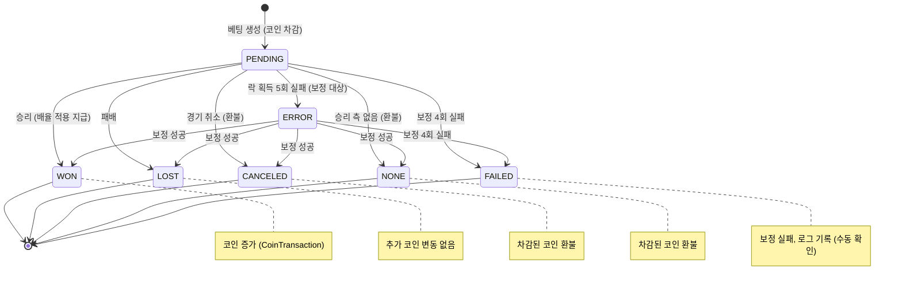
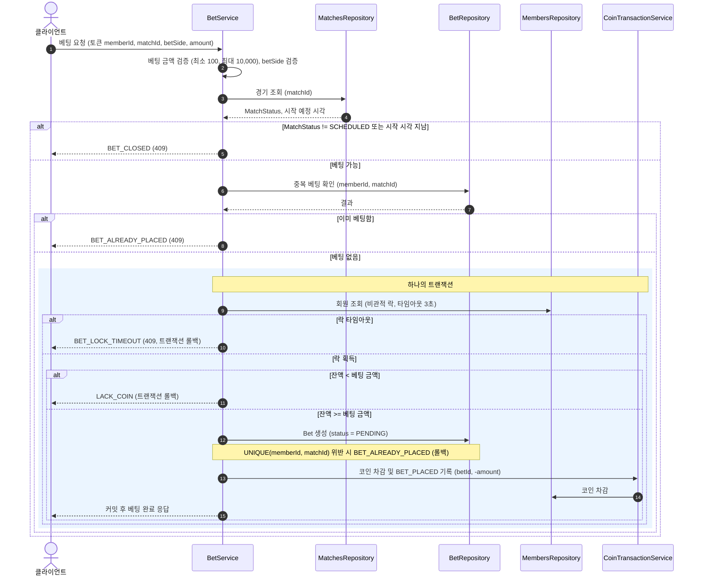
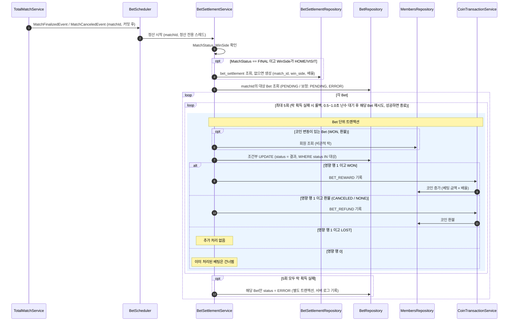
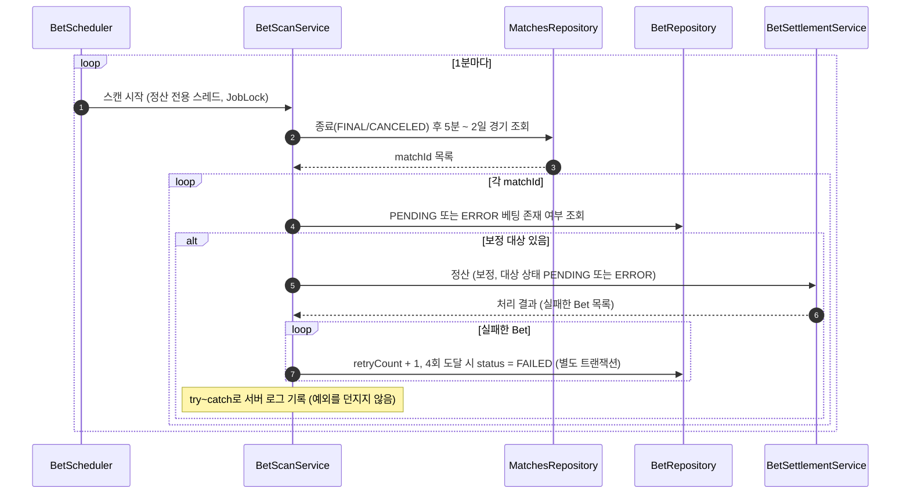

# 베팅 시스템 설계 (docs/design/Bet/BetSystemDesign.md)

> 상태: 구현 완료(1차) / 작성일: 2026-11-20
> `[미결]` = 아직 결정되지 않은 항목.

---

## 1. 개요와 원칙

- 기존 시스템과 동일하게 트랜잭션을 최소화하여 트랜잭션 내부의 지연을 줄인다.
- 정산 시스템은 정합성이 가장 중요하므로 락과 쿼리를 통해 데이터의 정합성을 지킨다.
- 모든 에러 처리 작업(ERROR, FAILED, retryCount 기록 등)은 별도의 트랜잭션에서 진행한다.
- 정산·보정은 경기 폴링 스레드가 아닌 정산 전용 스레드(`betTaskExecutor`)에서 실행한다. (락 대기·재시도 대기 동안 경기 폴링이 멈추지 않도록)
- 베팅 금액
    - 최소 베팅액은 100 coin이다.
    - 최대 베팅액은 플레이어의 등급에 따라 10,000 ~ 10,000,000 coin으로 변한다. 등급 시스템이 구현되기 전까지는 최솟값인 10,000 coin을 기준으로 한다.
    - 설정: `bet.min-amount`, `bet.max-amount`
- 배당 정산식: 경기당 `배율 = 2.05 − w/t`
    - w: 승리 쪽 베팅 금액의 합
    - t: 전체 베팅 금액의 합
    - \배율은 소수 4자리에서 버림, 지급액(`금액 × 배율`)은 소수점 이하 버림. 배율 범위는 1.05(전원 승리 측) ~ 2.05(승리 측 0원).
    - t = 0(베팅 없음)이면 정산식을 계산하지 않고 bet_settlement도 만들지 않는다.

## 2. 엔티티

### 2.1 Bet

생성된 베팅에 관한 정보를 가진다.

| 필드 | 설명 |
| --- | --- |
| matchId | 베팅 대상 경기 |
| memberId | 베팅한 회원 |
| amount | 베팅 금액 |
| betSide | 베팅한 팀 (**(변경)** HOME / VISIT만 허용, NONE 불가) |
| status | 베팅 상태 (기본값 PENDING) |
| retryCount | 보정 시도 실패 횟수 |
| createdAt / settledAt | 생성 / 정산 시각 |
- `UNIQUE(memberId, matchId)`: 한 회원은 한 경기에 한 번만 베팅할 수 있다.
- 탐색 효율을 위해 matchId와 memberId에 인덱스를 적용한다.
- **(변경)** status는 엔티티 메서드로 바꾸지 않고, `BetRepository`의 조건부 UPDATE로만 바꾼다.

### 2.2 CoinTransaction

코인의 이동 기록을 담당한다. 사유는 `PointReason`으로 구분한다.

```java
public enum PointReason { SIGNUP_BONUS, CHARGE, BET_PLACED, BET_REWARD, BET_REFUND }
```

- `betId + pointReason`에 복합 UNIQUE 제약을 둔다. (betId가 NULL인 가입 보너스·충전 기록은 제약 대상이 아니다)
- **(변경)** amount는 부호를 포함한다. 차감(BET_PLACED)은 음수, 지급(BET_REWARD)·환불(BET_REFUND)은 양수.
- 데이터 삽입은 CoinTransactionService의 별도 서비스 메서드를 통해서만 수행한다.
    - **(변경)** "별도 메서드"는 별도 트랜잭션이 아니다. 잔액 변경·기록·Bet 상태 변경이 함께 커밋/롤백되어야 하므로 호출자 트랜잭션에 참여한다(`Propagation.MANDATORY`, 트랜잭션 밖에서 호출하면 예외).
    - 잔액 변경과 기록은 항상 이 서비스에서 함께 수행한다(기록 없는 잔액 변경 금지).
- UNIQUE 제약 위반 예외가 발생하면, CoinTransaction의 `(betId, pointReason)` 복합키로 기존 데이터를 조회하여 삽입하려던 데이터의 coin과 비교한다.
    - **(변경)** 같으면: 코인은 이미 처리된 것으로 보고, 코인 변경 없이 Bet 상태만 정정한다(별도 트랜잭션).
    - **(변경)** 다르면: 불일치로 ERROR 로그를 남기고 해당 Bet을 실패로 집계한다. (ERROR 상태는 락 실패 전용이므로 표시하지 않음, 보정 4회 실패 시 FAILED)

### 2.3 bet_settlement

경기별 정산식 결과를 저장한다.

| 필드 | 설명 |
| --- | --- |
| id | PK |
| match_id(UNIQUE) | 경기 ID |
| win_side | 승리 측 |
| odds | 정산식(`2.05 − w/t`)으로 계산한 해당 경기의 배율 (DECIMAL(6,4)) |
| win_amount | **(변경)** w: 승리 측 베팅 금액 합 (계산 근거) |
| total_amount | **(변경)** t: 전체 베팅 금액 합 (계산 근거) |
| created_at | 생성 시각 |

## 3. 베팅 상태



| 상태 | 의미 |
| --- | --- |
| PENDING | 베팅 생성 직후, 정산 전 |
| WON | 승리. 베팅 금액에 배율을 적용해 지급 |
| LOST | 패배. 추가 코인 변동 없음 |
| CANCELED | 경기 취소(우천 등). 차감된 코인 환불 |
| NONE | 승리 측이 NONE인 경우. 차감된 코인 환불 |
| ERROR | 정산 중 락 획득 실패. 보정 대상 |
| FAILED | 보정 작업도 실패한 상태. 차감된 코인이 처리되지 않은 상태이므로 수동 확인 필요 |

- **(변경)** `PENDING --> FAILED` 추가: 보정 스캔은 PENDING Bet도 처리하므로(이벤트 유실·크래시), PENDING 상태에서 보정 4회 실패도 가능하다.
- **(변경)** `BetStatus` enum에 FAILED 추가.

## 4. 베팅 생성

### 4.1 절차

1. 사용자는 MatchStatus가 SCHEDULED**이고 현재 시각이 경기 시작 예정 시각 이전**인 경기에 한해 베팅을 요청할 수 있다. **(변경)**
    - **(변경)** 원안의 "경기가 스케줄러에 등록되면 베팅 이벤트 발생"은 별도 이벤트 없이 상태·시각 확인으로 대신한다. (경기 저장 = SCHEDULED이므로 동일한 의미)
    - **(변경)** 시작 시각 확인을 추가한 이유: LIVE 감지는 status 폴링(1분 주기)이라, 시작 직후 최대 1분간 SCHEDULED로 남아 있다.
2. 동일한 `[memberId, matchId]`의 Bet이 이미 존재하면 중복 접근으로 차단한다. `UNIQUE` 제약으로 이중 방어한다. (베팅 수정은 도메인을 분리하여 처리할 예정이다.)
3. 회원 락 조회 → 잔액 확인 → 베팅 생성 → 코인 차감은 하나의 트랜잭션으로 묶는다. (1~2번 확인은 트랜잭션 밖)
    - 코인 조회와 코인 차감은 비관적 락으로 중복 접근을 차단한다.
    - 비관적 락의 타임아웃은 3초이다. 타임아웃이 발생하면 해당 베팅은 생성하지 않고, 클라이언트에게 예외(409 `BET_LOCK_TIMEOUT`)를 던져 실패를 명시적으로 알린다.
        - **(변경)** MySQL은 쿼리 단위 락 타임아웃(`FOR UPDATE WAIT n`)을 지원하지 않p/는다. 커넥션 단위 `innodb_lock_wait_timeout = 3`(Hikari `connection-init-sql`)으로 적용한다. 앱의 모든 락 대기(경기 락 포함)가 3초로 바뀐다(기본 50초).
    - 조회된 잔액이 베팅 금액보다 적으면 예외(`LACK_COIN`)를 발생시킨다.
4. 코인 차감은 CoinTransaction에 기록해야 하며, CoinTransactionService의 별도 메서드를 통해 처리한다.
5. 추후 경합이나 불일치가 발생하면 베팅 생성 로직을 전용 큐로 처리할 예정이다.
6. **(변경)** API: `POST /api/bets` (인증 필요). memberId는 요청 본문이 아니라 **JWT 토큰의 principal**에서 가져온다. (원안처럼 요청으로 받으면 다른 회원 이름으로 베팅 가능)
    - 요청: `{ matchId, betSide(HOME|VISIT), amount }`, 응답: `{ betId, matchId, betSide, amount, status, coinRemain }`

| 상황 | HTTP | ErrorCode |
|---|---|---|
| 금액 범위 밖 | 400 | BET_INVALID_AMOUNT |
| betSide가 NONE | 400 | BET_INVALID_SIDE |
| 없는 경기 | 404 | MATCH_NOT_FOUND |
| SCHEDULED가 아님 / 시작 시각 지남 | 409 | BET_CLOSED |
| 이미 베팅함 (사전 확인 또는 UNIQUE 위반) | 409 | BET_ALREADY_PLACED |
| 회원 락 3초 초과 | 409 | BET_LOCK_TIMEOUT |
| 잔액 부족 | 400 | LACK_COIN |
| 없는 회원 | 404 | MEMBER_NOT_FOUND |
p
### 4.2 시퀀스 다이어그램



## 5. 정산

### 5.1 원칙

- 코인 정산은 Bet 하나의 정산을 하나의 트랜잭션으로 묶는다(Bet 단위). 같은 경기에는 같은 memberId의 Bet이 존재하지 않으므로, 한 경기의 Bet들은 서로 락 경쟁을 하지 않는다. 예외 상황이 발생하면 해당 트랜잭션을 롤백하여 락을 반납하고, 해당 Bet의 트랜잭션만 다시 시도한다.
- 동시에 여러 경기가 종료되면 한 회원의 데이터를 여러 정산이 동시에 수정할 수 있으므로, 회원 데이터에 대한 접근은 락으로 제한한다. 속도가 느려지더라도 데이터의 정합성을 우선한다.
- BetStatus는 조회 후 판단하지 않고 조건부 UPDATE로 변경한다. 확인과 변경 사이에 다른 정산(이벤트 또는 보정)이 개입할 수 없도록 하여 이중 지급을 방지한다. CoinTransaction의 `(betId, pointReason)` UNIQUE 제약은 이를 보완하는 마지막 방어선이다.
- 경기 전체의 원자성은 보장하지 않는다. 일부 Bet만 정산된 중간 상태는 각 Bet 처리의 멱등성과 보정 스캔으로 최종 정합성에 수렴시킨다.
- **(변경)** 정산 시작: 매치 시스템의 `MatchFinalizedEvent`(FINAL 확정 커밋 후)와 `MatchCanceledEvent`를 받아 정산 전용 스레드에서 실행한다.

### 5.2 절차

1. MatchStatus를 조회한다.
    - CANCELED이면 코인을 환불한다. (BetStatus = CANCELED)
    - FINAL이면 WinSide를 조회한다. WinSide가 NONE이면 동일하게 환불한다. (BetStatus = NONE)
    - **(변경)** FINAL이고 WinSide가 HOME/VISIT이면 bet_settlement를 생성(또는 기존 값 사용)한다. 원안의 "위 두 조건에 해당하지 않으면 생성"은 LIVE·MATCH_SUSPENDED_UNKNOWN 같은 미종료 경기도 포함되므로 조건을 명시했다.
    - **(변경)** FINAL·CANCELED가 아니면 정산하지 않는다(로그 후 건너뜀).
    - 환불은 matchId를 참조하는 각 Bet에 대해 Bet 단위 트랜잭션으로 처리한다. 조건부 UPDATE로 BetStatus를 변경하고, 영향받은 행이 1인 경우에만 CoinTransaction(BET_REFUND)에 기록하고 코인을 환불한다.
    `UPDATE bet SET status = :result WHERE id = :id AND status = 'PENDING'`
    - 환불도 2번의 1~4(회원 락, 조건부 UPDATE, 영향 행 1일 때만 기록)와 4번의 재시도·ERROR 규칙을 동일하게 따른다. **(변경: 원안의 "3번의 1~4"는 2번을 가리키는 오기)**
2. 배율이 저장된 뒤, 해당 matchId를 참조하는 모든 Bet을 조회하고, 각 Bet을 Bet 단위 트랜잭션으로 처리한다.
    1. 회원 데이터를 비관적 락으로 조회한다(타임아웃 3초).
        - **(변경)** LOST처럼 코인 변동이 없는 Bet은 회원 락을 잡지 않는다. (조건부 UPDATE만으로 이중 처리가 막히므로, 불필요한 락 경쟁만 늘어남)
    2. 조건부 UPDATE로 BetStatus를 변경한다. (:result는 WON 또는 LOST이며, 승패 판정은 UPDATE 전에 betSide와 WinSide를 비교하여 정한다.)
    `UPDATE bet SET status = :result, settled_at = :now WHERE id = :id AND status IN (:target)`
        - target: 이벤트 정산은 `PENDING`, 보정은 `PENDING, ERROR`
    3. 영향받은 행이 1이면(처음 처리한 경우) 후속 처리를 진행한다.
        - WON: CoinTransaction(BET_REWARD)을 기록하고 회원 코인을 증가시킨다(베팅 금액 × 배율, 버림).
        - LOST: 추가 처리 없음.
    4. 영향받은 행이 0이면 이미 다른 정산이 처리한 것이므로 오류 없이 건너뛴다.
3. bet_settlement는 matchId에 맞는 정산식 결과를 저장한다(id, match_id, win_side, odds, win_amount, total_amount).
    - **(변경)** 원안의 `win_amount`(배율 저장)는 2.3의 `odds`와 이름이 달라, 배율은 `odds`에 저장하고 `win_amount`는 이름 그대로 w(승리 측 금액 합)를 저장한다.
    - w와 t는 해당 경기의 모든 Bet의 금액 합(BetStatus와 무관)으로 계산한다.
    - match_id가 UNIQUE이므로, 이미 존재하면 새로 계산하지 않고 기존 값을 사용한다. 동시에 생성되어 UNIQUE 위반이 나면 먼저 저장된 값을 읽는다.
4. 락에 막힌 트랜잭션은 0.5~1.0초의 난수 시간 대기 후 해당 Bet의 트랜잭션을 다시 시도한다.
    - **(변경)** 5회 모두 락 획득에 실패하면 해당 Bet만 ERROR로 처리하고(별도 트랜잭션) 예외를 서버 로그에 기록한다. 다른 Bet의 정산에는 영향을 주지 않는다. (원안 "5회 이상"은 "5회 모두"의 의미)
    - ERROR는 락 획득 실패에 한해 사용한다. DB 연결 장애처럼 특정 Bet에 귀속되지 않는 오류는 ERROR로 표시하지 않고 경기 정산을 중단하며, 다음 보정 스캔에서 재처리한다.
    - ERROR Bet의 보정 시에는 조건부 UPDATE의 대상 상태를 `status IN ('PENDING', 'ERROR')`로 한다.
    - 설정: `bet.lock-retry-max-attempts: 5`, `lock-retry-min-wait: 500ms`, `lock-retry-max-wait: 1000ms`

### 5.3 시퀀스 다이어그램



## 6. 보정 스캔

1. 1분마다 종료된 지 5분이 지난 경기 ~ 2일 전 경기들을 스캔하고, 해당 경기의 엔티티에 대한 보정 작업을 진행한다.
    - **(변경)** "종료"는 FINAL과 CANCELED이며, 기준 시각은 `matches.ended_time`이다. CANCELED 전이 시에도 ended_time을 기록하도록 매치 시스템을 수정했다. (원래는 FINAL만 기록해서 취소 경기가 스캔되지 않았음)
- 보정 대상: 해당 matchId의 이벤트 유실, 정산 중 크래시, ERROR 베팅(BetStatus == ERROR)
- 보정 작업은 4회만 진행한다. 보정 작업도 실패하면 해당 BetStatus를 FAILED로 지정한다.
    - **(변경)** 보정 실행에서 처리하지 못한 Bet마다 retryCount를 1 늘리고, retryCount가 4에 도달하면 FAILED로 바꾼다(별도 트랜잭션).
    - **(변경)** "실패"로 집계하는 것: 락 5회 실패, 코인 기록 불일치. 경기 전체 정산을 중단시키는 DB 장애는 Bet에 귀속되지 않으므로 집계하지 않는다(다음 스캔에서 재시도).
- try~catch로 처리하여 로그에 기록한다(예외를 던지지 않는다). 한 경기의 실패가 다른 경기 보정을 막지 않는다.
- 스캔은 BetScheduler에서 1분 주기로 발생하며, 스캔에 대한 처리 작업은 BetScanService 클래스에 구현한다.
    - **(변경)** 스캔도 정산 전용 스레드에서 실행하고, JobLock으로 스캔끼리 겹치지 않게 한다.
- 설정: `bet.scan-delay-after-end: 5m`, `scan-window: 2d`, `max-correction-attempts: 4`



## 7. 추후 개선

- 베팅 생성 로직의 전용 큐 처리(경합이나 불일치가 확인될 때)
- 플레이어 등급에 따른 최대 베팅액 적용
- 베팅 수정 도메인 분리
- **(변경: 추가)** 가입 보너스(SIGNUP_BONUS)·충전(CHARGE): 현재 회원 코인 초기값이 0이라 베팅할 수 없음
- **(변경: 추가)** FAILED Bet 수동 처리 도구(관리자 API 또는 운영 스크립트)
- **(변경: 추가)** 동시성 통합 테스트(실제 MySQL, Testcontainers): 락 대기·타임아웃·이중 정산 방지를 실제 DB로 검증

## 8. 설계 검토 결과 (2026-11-20)

### 8.1 오류 (그대로 구현하면 문제가 되는 부분)

| # | 위치 | 문제 | 조치 |
|---|---|---|---|
| 1 | 4.1, 4.2 | 요청에 memberId를 받음 → 다른 회원 이름으로 베팅 가능 | 토큰 principal 사용, `/api/bets` 인증 경로 추가 |
| 2 | 4.1-3 | MySQL은 쿼리 단위 락 타임아웃 미지원 → "3초" 설정이 적용되지 않고 기본 50초 대기 | 커넥션 단위 `innodb_lock_wait_timeout=3` |
| 3 | 4.1-1 | SCHEDULED만 확인 → 실제 시작 후 최대 1분간 베팅 가능 | 시작 예정 시각 확인 추가 |
| 4 | 2.3 ↔ 5.2-3 | 배율 컬럼 이름이 `odds` / `win_amount`로 다름 | `odds`로 통일, `win_amount`는 w 저장 |
| 5 | 1장 정산식 | t = 0이면 0으로 나누기 | 베팅 없으면 계산·저장 안 함 |
| 6 | 1장 정산식 | 배율·지급액 소수 처리 규칙 없음 | 배율 소수 4자리 버림, 지급액 정수 버림 |
| 7 | 5.2-1 | "두 조건 외에는 bet_settlement 생성" → 미종료 경기도 정산됨 | FINAL + HOME/VISIT일 때만, 그 외 건너뜀 |
| 8 | 5.2-1 | "3번의 1~4" 참조 오기 | 2번의 1~4로 수정 |
| 9 | 3장 | 보정 대상인 PENDING이 FAILED로 가는 전이 없음, enum에 FAILED 없음 | 전이·enum 추가 |
| 10 | 6장 | CANCELED 경기에 종료 시각이 없어 스캔 대상에서 빠짐 | 취소 시 ended_time 기록 (매치 시스템 수정) |
| 11 | 5.3 | 경기 종료 이벤트를 폴링 스레드에서 바로 정산하면 락 대기·재시도 대기(Bet당 최대 약 19초) 동안 폴링이 멈춤 | 정산 전용 스레드 |
| 12 | 2.2 | UNIQUE 위반 시 "비교" 이후 동작이 없음 | 같으면 상태만 정정, 다르면 실패 집계 |
| 13 | DB | 기존 `bet.status`가 MySQL ENUM(PENDING/WON/LOST/CANCELED) → NONE/ERROR/FAILED 저장 실패 | 수동 마이그레이션 SQL (`db/manual/2026-11-20_bet_system.sql`) |

### 8.2 개선 (원안을 바꾼 부분)

- LOST Bet은 회원 락 없이 조건부 UPDATE만 (불필요한 락 경쟁 제거)
- CoinTransaction amount 부호 규칙 (차감 음수, 지급/환불 양수)
- CoinTransactionService는 호출자 트랜잭션에 참여(MANDATORY)
- bet_settlement에 계산 근거(w, t) 저장
- 금액·재시도·스캔 수치를 설정으로 분리 (`bet.*`)

### 8.3 남은 결정 사항 `[미결]`

- MATCH_SUSPENDED_UNKNOWN 경기의 베팅 처리: 현재는 FINAL/CANCELED가 될 때까지 PENDING으로 유지. 끝내 확정되지 않으면 환불할지, 언제 할지
- 보정 스캔 범위(2일)를 지나도 PENDING/ERROR인 Bet 처리: 현재는 더 이상 스캔하지 않음
- FAILED Bet의 처리 주체·절차
- 락 타임아웃 3초가 매치 시스템의 경기 락에도 적용되는 것(기본 50초 → 3초) 확인. 경기 락 트랜잭션은 DB 작업만 해서 짧으므로 문제는 없을 것으로 봄
